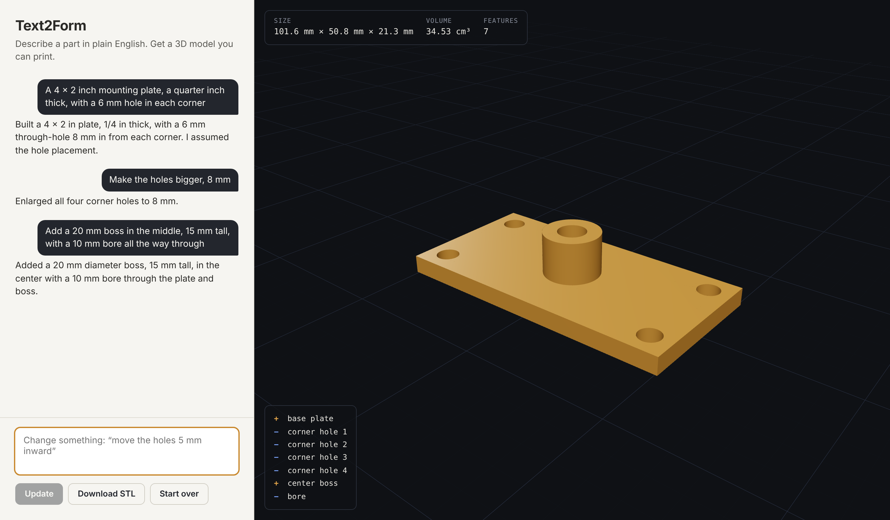

# Text2Form

**Describe a mechanical part in plain English and get a 3D model you can download and print.**

> "A 4 × 2 inch mounting plate, a quarter inch thick, with a 6 mm hole in each corner."
> "Make the holes bigger, 8 mm."
> "Add a 20 mm boss in the middle with a 10 mm bore all the way through."



Simple brackets, plates, and spacers take minutes in CAD, but only if you know CAD. Text2Form lets you describe the part, refine it over a few messages, and download an STL for your slicer.

## How it works

```
prompt + current model
        │
        ▼
  Claude (structured output) ──▶ CSG model (JSON, Zod schema)
        │                               │
        │◀── repair prompt ◀── semantic validator
        │      (up to 2x)          "cut misses the part", bad sizes, ...
        ▼
  three-bvh-csg ──▶ mesh ──▶ Three.js viewer + STL export
```

1. **Language → structure.** The LLM never writes geometry. It returns an intermediate representation: an ordered list of boxes, cylinders, and spheres, each one added or subtracted, all in millimeters. Claude's structured outputs guarantee the response matches the Zod schema in [`lib/model.ts`](lib/model.ts).
2. **Validate what a schema can't.** [`lib/validate.ts`](lib/validate.ts) checks for missing or out-of-range dimensions, a subtraction as the first step, and cuts that don't touch the part. The error messages are written to be sent straight back to the model.
3. **Repair loop.** If validation fails, the errors go back to the model as a follow-up turn, up to two times, before the user sees an error. See [`lib/llm.ts`](lib/llm.ts).
4. **Deterministic geometry.** CSG runs in the browser with [three-bvh-csg](https://github.com/gkjohnson/three-bvh-csg). The same model always produces the same mesh. The viewer reports bounding size and volume, and the STL is exported in millimeters.

**Conversation is the editor.** Each request includes the current model, so follow-ups like "move the holes 5 mm inward" edit the existing part instead of starting over. If a request is too vague to build (for example, no size at all), the model asks one clarifying question.

**Works without a key.** With no `ANTHROPIC_API_KEY`, the API route falls back to the original v1 rule-based parser ([`lib/parser.ts`](lib/parser.ts)). It understands a fixed set of commands like `create 2x2x2 in box` and `drill 6mm hole`.

## Run it

```bash
npm install
cp .env.example .env.local   # add your ANTHROPIC_API_KEY
npm run dev                  # http://localhost:3000
npm test                     # parser, validator, CSG volume, and repair-loop tests
```

## Deploy

It deploys to Vercel as-is. Import the repo and set `ANTHROPIC_API_KEY`. The API route caps prompts at 500 characters and rate-limits each IP to 10 requests a minute, so a public demo can't run up the bill.

## Stack

Next.js (App Router) · TypeScript · Claude API (structured outputs) · Zod · Three.js / React Three Fiber · three-bvh-csg · Vitest

## Limits and next steps

- Primitives are boxes, cylinders, and spheres, with no rotation beyond a cylinder's axis. Fillets, chamfers, and sketch-and-extrude are next.
- Meshes, not B-rep: exports are STL only. STEP export would need a kernel like OpenCascade.
- The original deterministic design notes are in [`docs/planning-v1.md`](docs/planning-v1.md).
